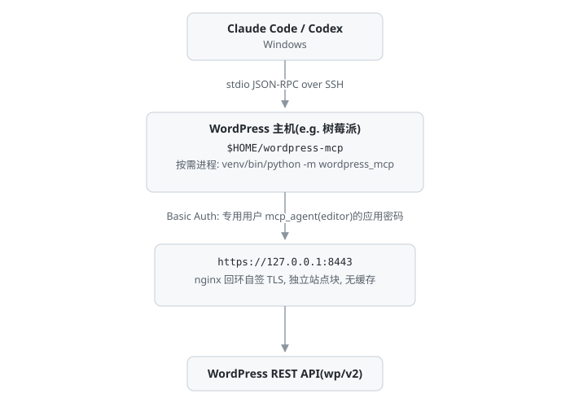

# wordpress-mcp

为 Claude Code 与 Codex 提供 WordPress 编辑接口的 MCP 服务器(stdio 传输)。

支持文章与页面的增删改查、分类与标签查询、媒体上传、Markdown 与 HTML 互转。WordPress 调用全部在服务器本机回环完成,凭据不离开服务器。

## 架构



## 安全模型

- 应用密码只存于服务器 `config.env`(0600);客户端仅持有 SSH 密钥。
- 回环 HTTPS 满足 WordPress 对应用密码的强制要求,不改 `wp-config.php`。
- MCP 入口不接主站点 fastcgi 缓存,编辑后读取不会返回过期内容。
- 新建文章默认草稿,删除默认进回收站;媒体上传有类型与 32 MiB 大小限制。
- 服务器无常驻进程,客户端会话按需拉起;配置错误启动即失败。
- SSH 密钥等同服务器账号的 shell 权限。生产环境建议给 MCP 单独 OS 用户,并在 `authorized_keys` 使用 `restrict,command="<install-dir>/bin/mcp-server"` 限制命令;部署/验证用另一把有 shell 权限的 key。

## 部署配置

客户端与开发机在仓库根目录使用 `.env`(已 gitignore,不会上传到服务器):

```dotenv
MCP_SSH_HOST=user@host
MCP_SERVER_DIR=/home/user/wordpress-mcp
```

复制 `.env.example` 后填写。优先级:命令行参数 > 环境变量 > `.env` > 默认值。`MCP_SERVER_DIR` 必须与 `install.sh --server-dir` 一致;服务器侧默认 `$HOME/wordpress-mcp`。`install.sh` / `uninstall.sh` 从仓库检出运行时也会读取同目录 `.env`;管道安装没有检出目录,只认环境变量与参数。

`.env` 只保存部署参数;WordPress 运行时凭据在服务器的 `config.env`(0600),两者不要混用。

## 安装

### 服务器侧(Debian 系)

前提:Python ≥ 3.10(mcp 2.3 要求)、PHP CLI、nginx、openssl、curl,当前用户可 sudo。

```bash
git clone https://github.com/Aloudname/wordpress-mcp.git
cd wordpress-mcp
bash install.sh                              # 默认安装到 $HOME/wordpress-mcp
```

安装器依次完成:自动探测 WordPress 根目录与 PHP-FPM 套接字(多个候选项时要求显式指定);创建 venv 并安装锁定版本依赖;创建 `mcp_agent` 用户(editor)并签发应用密码;生成回环自签证书;写入独立 nginx 站点块(127.0.0.1:8443);PHP 8.4 display_errors 池级加固;运行只读 MCP 握手测试。重复执行幂等,修改 `--port`/`--wp-root`/`--php-socket` 会重新渲染 nginx 配置。

可选参数:`--wp-root`、`--php-socket`、`--port`、`--server-dir`、`--mirror`、`--regen-password`、`--no-harden-php`、`--skip-tests`。安装目录也可用 `MCP_SERVER_DIR` 环境变量指定;自定义目录时需在客户端 `.env` 中同步。

### 客户端侧(Windows)

```bat
copy .env.example .env
notepad .env
install.bat
```

也可直接传参(覆盖 `.env`):

```powershell
powershell -NoProfile -ExecutionPolicy Bypass -File install.ps1 -SshHost user@host -ServerDir /home/user/wordpress-mcp
```

安装器先经 SSH 在服务器侧运行只读 MCP 握手测试以验证连通性,再向 Claude Code(项目级 `.mcp.json`)与 Codex(`~/.codex/config.toml`)写入配置;已有配置则跳过。

参数:`-SshHost`(兼容旧名 `-PiHost`)、`-ServerDir`、`-EnvFile`、`-ClaudeScope project|user|skip`、`-SkipCodex`、`-Force`、`-SkipVerify`。

## 工具

共 14 个,前缀 `wp_`。

| 类别 | 工具 |
| --- | --- |
| 文章 | `wp_list_posts` `wp_get_post` `wp_create_post` `wp_update_post` `wp_delete_post` |
| 页面 | `wp_list_pages` `wp_get_page` `wp_update_page` |
| 分类与标签 | `wp_list_categories` `wp_list_tags` |
| 媒体 | `wp_list_media` `wp_upload_media` |
| 排版 | `markdown_to_html` `html_to_markdown` |

另有 `blog_writing_guide` prompt,向 Agent 注入写作与排版约定。

## 行为约定

- WordPress 对草稿不生成 slug,草稿以 ID 查询;slug 查询仅对已发布文章有效。
- 为草稿显式指定 slug 会触发 WP 7.1 核心未定义属性告警,由 PHP 8.4 加固步骤隐藏,不影响功能。
- 分类与标签参数接受名称或 ID;不存在时报错,不自动新建。

## 测试

测试是开发资产,不进入服务器运行目录。安装器只部署 `tests/test_mcp_handshake.py` 用于连通性验证;单元测试和真实站点 CRUD 测试留在源码仓库。

```bash
python -m pytest -q                            # 单元测试,不需要 WordPress
./venv/bin/python tests/test_wp_client.py      # 真实站点 CRUD 冒烟,非破坏(需 WP_* 或仓库根 config.env)
./venv/bin/python tests/test_mcp_handshake.py  # MCP stdio 协议握手与工具调用(服务器安装目录)
```

单元测试使用 `httpx.MockTransport`,覆盖参数清理、空字符串更新、错误翻译、分页、媒体名清洗与大小限制。CI 只运行单元测试。真实站点测试只由维护者手动运行,不会随安装部署。

## 卸载

```bash
bash uninstall.sh                       # 默认 $HOME/wordpress-mcp,保留 WP 用户
bash uninstall.sh --with-wp-user        # 同时删除用户
bash uninstall.sh --server-dir /srv/wordpress-mcp
```

若安装目录缺少 `bin/mcp-server` 与 `config.env` 标记,卸载器会拒绝删除;确认路径无误后可加 `--force`。

客户端:删除 `.mcp.json` 中 `wordpress-blog` 条目(或 `claude mcp remove wordpress-blog`);删除 Codex `config.toml` 中 `[wordpress-mcp-plugin]` 标记块。

## 密钥轮换

`install.sh --regen-password` 重新签发应用密码并更新 `config.env`;旧密码在 WP 后台「用户 → mcp_agent → 应用程序密码」撤销。

## 开发

- `deploy.sh` 读取 `.env` 幂等部署到服务器(开发迭代用,不写密钥);也可用 `--host`/`--server-dir` 覆盖。要求服务器侧已运行过一次 `install.sh`。只复制 `test_mcp_handshake.py` 用于客户端验证。
- 依赖锁定于 `requirements.txt`;`pyproject.toml` 为打包元数据,`pip install -e '.[dev]'` 可装 pytest。
- CI 检查:单元测试、Python 编译、shellcheck、JSON 校验。
- 新增工具:在 `wp_client.py` 添加客户端方法,在 `server.py` 添加带安全注解的 `@mcp.tool(annotations=...)` 函数,并同步更新握手测试的工具集合断言。

## License

MIT
